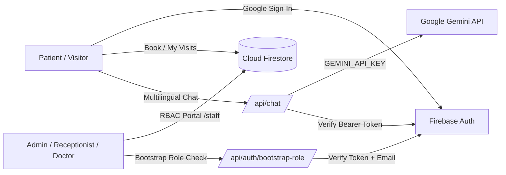

# FourClinic — AI-Powered Dental Clinic Website & Management Dashboard

FourClinic is a full-stack dental clinic platform combining a responsive patient booking storefront, a multilingual AI dental receptionist (**English · اردو · Roman Urdu**), and a role-based clinic management dashboard powered by **Firebase Authentication**, **Cloud Firestore Security Rules**, and server-side **Gemini AI** (`@google/genai`).

> **Portfolio Demo Disclaimer:** All preloaded dental specialists, sample reviews, insurance marquee items, and optional sample records marked `SAMPLE` are fictional demonstration data. Do not enter real protected health information (PHI) in demo deployments.

---

## System & Firebase Architecture

```
+-----------------------------------------------------------------------------+
|                     Browser Client (React 19 + Vite SPA)                    |
|                                                                             |
|  Public Website (/)                         Staff Portal (/staff)           |
|  - Hero, Gallery Lightbox & Whitening       - Overview KPIs (live DB)       |
|  - Services & Transparent Pricing           - Appointments & 7-Day Calendar |
|  - Live Duration-Aware Slot Picker          - Doctors, Leave & Schedules    |
|  - Patient "My Visits" (.ics / Resched)     - Patient Directory & CRM       |
|  - Multilingual AI Receptionist Widget      - Recharts Analytics & Audit    |
+-------------------+-----------------------------------+---------------------+
                    |                                   |
                    | Firebase Client SDK               | HTTPS JSON (/api/*)
                    v                                   v
+---------------------------------------+   +---------------------------------+
|   Firebase Auth & Cloud Firestore     |   | Server API (/lib/serverHandlers)|
|                                       |   | Express (dev) / Vercel (/api/*) |
|  - Google Sign-In (ID Tokens)         |   |                                 |
|  - /users/{uid} (RBAC + email_verified|   | - GET  /api/health              |
|  - /doctors, /services, /clinicSettings   | - POST /api/auth/verify         |
|  - /schedules (leave & slot overrides)|   | - POST /api/auth/bootstrap-role |
|  - /slotLocks/{doc_date_HHMM} (atomic)|   | - POST /api/chat (Gemini AI +   |
|  - /appointments (full-duration tx)   |   |   UID/IP rate limit + triage)   |
|  - /patients, /inquiries, /auditLogs  |   |                                 |
+---------------------------------------+   +---------------------------------+
```



---

## Key Features & Role-Based Access Control (RBAC)

### Public Patient Website (`/`)
- **Brand-Consistent Responsive Storefront:** `#4d8a96` clinical teal, `#12262e` deep slate, `Plus Jakarta Sans`, interactive SVG before/after whitening comparison slider, and keyboard-accessible clinic gallery lightbox.
- **Full-Duration Atomic Slot Locking:** `generateAvailableSlotsForDoctor()` filters open times against clinic hours, doctor hours, lunch breaks, holidays, doctor leave overrides, and existing reservations across the **entire service duration** (`30m`–`120m+`), then writes `/appointments/{id}` and `/slotLocks/{doctorId_date_HHMM}` inside a single `runTransaction()`.
- **Patient Self-Service (`My Visits`):** Authenticated patients view only their own appointments, download `.ics` calendar invites, reschedule (releasing unused slot locks cleanly), or cancel with two-step confirmation.
- **Multilingual AI Dental Receptionist (`Ask FourClinic AI`):**
  - Speaks **English, Urdu (اردو), and Roman Urdu** naturally using live non-PII catalog & duration-verified slot data.
  - Builds a booking draft interactively and requires explicit patient click (**Confirm & Submit Request**) to run the Firestore booking transaction.
  - Flags acute pain/bleeding/swelling to the front-desk CRM without giving medical diagnoses or fabricating reference numbers.

### Role Permissions Matrix

| Role | Default Assignment | Permitted Views & Actions | Blocked Access |
| :--- | :--- | :--- | :--- |
| **Patient** | All new Google sign-ins | Book visits, view/reschedule/cancel **own** appointments, submit **own** inquiries, AI chat | Blocked from `/staff`, `/patients`, `/users`, `/auditLogs`, and other patients' records |
| **Doctor** | Assigned by Admin | Overview, **assigned** appointments (`complete` / `no_show`), own hours & leave overrides, patient directory | Cannot view unassigned appointments, edit clinic settings/pricing, or change user roles |
| **Receptionist** | Assigned by Admin | All appointments (walk-in, confirm, reschedule, cancel, CSV, 7-day calendar), doctor leave overrides, patients, CRM inquiries, analytics | Cannot change user roles, clinic settings, or delete doctors/services |
| **Admin** | Server-verified bootstrap (`BOOTSTRAP_ADMIN_EMAIL`) or Admin promotion | Full clinic control: Doctors & Services CRUD, clinic hours/holidays/slot duration, RBAC role management, audit logs, demo data seeding | Protected by verified Google token & Firestore security rules |

---

## Tech Stack

- **Frontend:** React 19, TypeScript, Tailwind CSS v4, Lucide React, Recharts, Vite 8
- **Backend / Serverless:** Express 5 (`server.ts`) for local dev + Vercel serverless handlers (`/api/health.ts`, `/api/auth/verify.ts`, `/api/auth/bootstrap-role.ts`, `/api/chat.ts`) sharing `/lib/serverHandlers.ts`
- **Database & Auth:** Firebase Auth (Google Sign-In) + Cloud Firestore with rules in `/firestore.rules` (linted via `@firebase/eslint-plugin-security-rules`)
- **AI & Rate Limiting:** `@google/genai` (`gemini-4-hydrogen`) strictly server-side, paired with per-UID / per-IP sliding-window rate limiting (`20 req / 60s`) with optional **Upstash Redis REST** persistence across Vercel serverless instances

---

## Local Development

1. **Install dependencies:**
   ```bash
   npm install
   ```
2. **Configure environment variables (never commit `.env`):**
   ```bash
   cp .env.example .env
   ```
   Set `GEMINI_API_KEY` (and optionally `BOOTSTRAP_ADMIN_EMAIL`, `UPSTASH_REDIS_REST_URL`, `UPSTASH_REDIS_REST_TOKEN`).
3. **Run dev server (port 3000):**
   ```bash
   npm run dev
   ```
4. **Verify TypeScript, ESLint, Firestore Rules, Production Build & Automated Tests:**
   ```bash
   npm run lint
   npx eslint firestore.rules
   npm run build
   npx tsx src/lib/validation.test.ts
   ```

---

## Safe Portfolio Demo Mode

- **Fictional Seeded Catalog:** Doctors, services, and clinic hours seed idempotently once via Firestore transaction when an authorized Admin signs in.
- **Sample Records:** The Admin Overview includes a **Load Demo Sample Data** action that populates clearly tagged `SAMPLE` appointments, patients, and urgent inquiries so reviewers can showcase dashboards and Recharts analytics immediately without entering real patient data.
- **Public Read Isolation:** Unauthenticated visitors can browse public clinic catalogs (`/doctors`, `/services`, `/schedules`, non-PII `/slotLocks`) and chat with the AI receptionist, while `/appointments`, `/patients`, `/users`, `/inquiries`, and `/auditLogs` remain strictly deny-by-default.

---

## Vercel + Firebase Deployment Checklist

1. **Firebase Console Setup:**
   - Ensure `firebase-applet-config.json` references your Firebase project (`projectId`, `firestoreDatabaseId`).
   - Enable **Google** under **Firebase Authentication → Sign-in method**.
   - Add your Vercel preview & production domains (e.g., `your-app.vercel.app`) under **Authentication → Settings → Authorized domains**.
   - Deploy security rules from `/firestore.rules` after running `npx eslint firestore.rules`.
2. **Vercel Project Settings:**
   - Framework Preset: `Vite` (handled automatically via `vercel.json` SPA + `/api/*` rewrites).
   - Add **Environment Variables** in Vercel (**never** prefix secrets with `VITE_`):
     - `GEMINI_API_KEY` (required for `/api/chat`)
     - `BOOTSTRAP_ADMIN_EMAIL` (recommended: initial verified Admin email)
     - `UPSTASH_REDIS_REST_URL` & `UPSTASH_REDIS_REST_TOKEN` (recommended for distributed serverless rate limiting across cold starts)
3. **Post-Deploy Verification:**
   - Visit `/api/health` and verify `ok: true`, `geminiConfigured: true`, and `rateLimitMode`.
   - Test Google Sign-In as Admin -> confirm `/staff` loads and catalog initializes.
   - Test Google Sign-In as a secondary account -> confirm role defaults to `patient` and `/staff` denies access.
